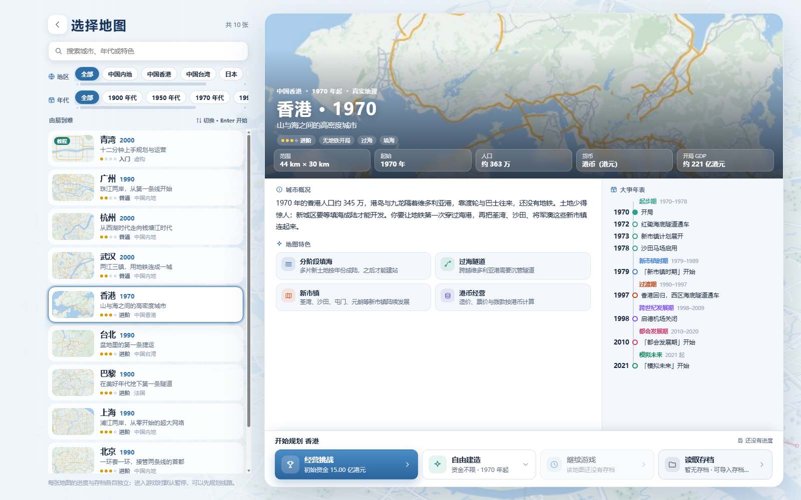
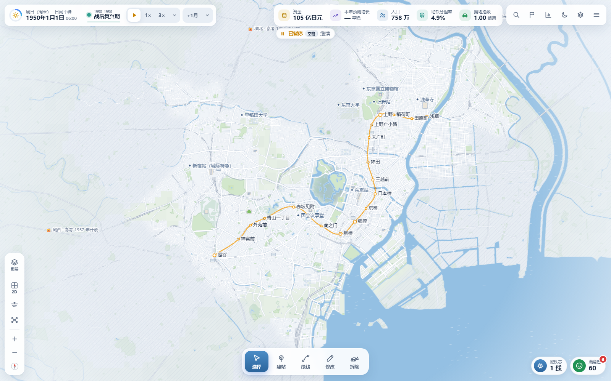
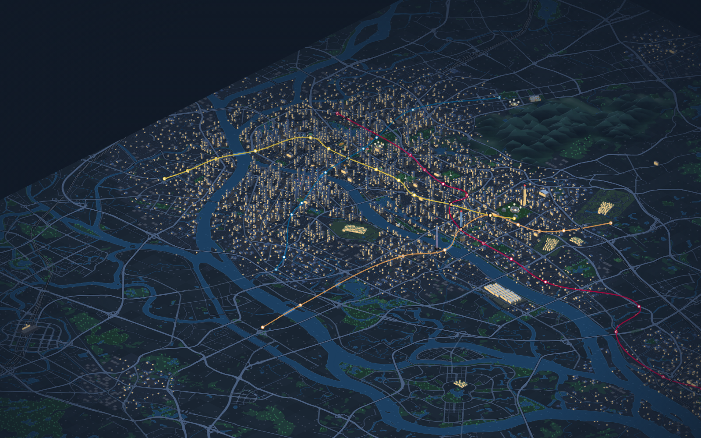
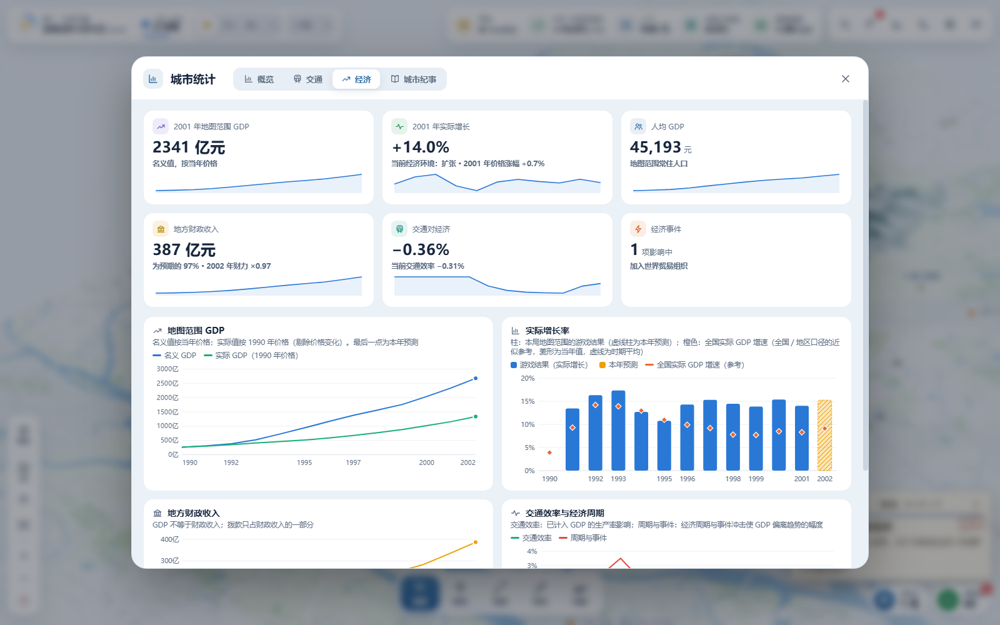

# City and Metro

[繁體中文](./README.md) · **English**

**Draw your own metro in real cities.**

City and Metro is a single-player metro planning and city management game that runs in the browser. Start with a single station, connect homes, business districts, campuses and airports, cross rivers, and grow your own transit network. The city develops across the decades, and residents change how they travel as your network evolves.

**[Play online](https://city-and-metro.yijiun.com)** · [Source code](https://github.com/yijiunchin/city-and-metro) · [Original game](https://city-and-metro.pages.dev) · [License](./LICENSE.txt) · [Third-party notices](./THIRD_PARTY_NOTICES.txt)

> [!IMPORTANT]
> **This is a community-modified version, not the official release.**
> Original author: [VinsonFung](https://github.com/VinsonFung) · Original site: [City and Metro](https://city-and-metro.pages.dev) · Original repository: [VinsonFung/city-and-metro](https://github.com/VinsonFung/city-and-metro)
>
> This version is published under the original author's community-version rules and **must not be used commercially in any way**. For the core game, refer to the original release. Features added here (account sign-in, cloud sync, automatic language detection and Cloudflare Workers deployment) are maintained in this repository; please do not open pull requests about them against the original repository.

---

## Contents

- [What this version adds](#what-this-version-adds)
- [Features](#features)
- [Screenshots](#screenshots)
- [Cities and starting years](#cities-and-starting-years)
- [Getting started](#getting-started)
- [Account and cloud sync](#account-and-cloud-sync)
- [Interface language](#interface-language)
- [Local saves, import and export](#local-saves-import-and-export)
- [Controls](#controls)
- [Architecture](#architecture)
- [Project layout](#project-layout)
- [Local development](#local-development)
- [Deploying to Cloudflare](#deploying-to-cloudflare)
- [API reference](#api-reference)
- [Tests and checks](#tests-and-checks)
- [Original documentation](#original-documentation)
- [Copyright and license](#copyright-and-license)

---

## What this version adds

| Feature | Description |
| --- | --- |
| **Sign in with Google** | Optional. Without signing in, the game behaves exactly like the original and stays fully local. |
| **Cross-device cloud sync** | Once signed in, all settings and every save sync automatically across computers, phones and browsers, and are backed up to the cloud. |
| **Remembered game preferences** | Remembers your last game speed (e.g. 24×) and which panel sections you expanded; after a reload, loading a save or starting a new map, Resume uses that speed. Synced with your settings when signed in. |
| **Automatic interface language** | Shows Traditional Chinese, Simplified Chinese or English based on your browser or device language by default; you can still pick one manually. |
| **Cloudflare Workers deployment** | Moved from Cloudflare Pages to Workers (static assets + API) with D1 and R2, served at `city-and-metro.yijiun.com`. |

The game itself is synced with the original **v2.5.1**. Apart from the fixes below, gameplay, maps, economy and traffic model follow the original.

### Fixes in this edition

- **City goals whose target area is not yet open**: the original could issue a connect-type phase goal before the target's district opened (for example Tokyo's "Kita-Senju Transfer" in 1956, while Kita-Senju's Joto district only opens in 1962), making it impossible before the deadline. This edition waits until the district opens; such goals already issued in existing saves are withdrawn on load without reducing grants or satisfaction, and are reissued once the district opens.

## Features

- **Choose a city and an era.** Nine real cities plus the Qingwan tutorial map, each with its own terrain, development phases and local goals. Free Build can also start in a later year and unlock the whole map.
- **Plan your own network.** Build underground, at-grade and elevated lines; design curves, loops, branches and multi-level interchanges; set platform directions; split or through-run lines. Drafts can be previewed and undone before they open for service.
- **Run a city's metro.** Play with unlimited funds, or balance construction, operations, fares, grants and debt in the management challenge. Use ridership, congestion, walking coverage and construction impact reports to decide what to do next.
- **Grow with the city.** New districts, airports, campuses and scenic areas open over time, and historical events affect travel and the economy. Complete facility access tasks and read phase summaries and city chronicles. Off-map airports show direction, distance and demand at the edge of the map; connect a line to the edge portal to serve them.
- **Watch life in your network.** Switch between 2D, 2.5D and underground views, follow trains into stations, and watch street traffic, landmarks and the city at night. Ambient sound follows the camera's district.
- **Let the metro shape the city.** Once stations open, residents gradually switch to the metro and new homes and jobs cluster around stations.
- **Develop and decorate stations.** Add advertising and convenience stores, station malls and integrated station-city development for non-fare income; choose styles, theme colours, public art and signage.
- **Manage fleets and service patterns.** 43 train models unlock by city and era and can be bought, reassigned and sold. Schedule trains for peaks, off-peak and night, pick line speeds from 40 to 120 km/h, and run express and short-turn services.
- **Run the network from Metro Core.** Manage the overview, lines, stations and trains in one place; persistent overloads can be located or handled automatically.
- **Take on government contracts.** In the management challenge you can bid for new-line PPP, rail-plus-property and capacity projects, paid according to construction and operating performance.
- **Complete compound goals.** New tasks combine network, coverage, operations, finance or development targets; the nine cities also offer 18 optional strategy challenges.
- **Twelve analysis layers and four tools.** Including commute time, metro share, commercial development, distance measurement, line labels and task markers.
- **Desktop and mobile.** Touch supports dragging and pinch zoom, with a dedicated phone layout.

## Screenshots

The screenshots below are from the original **v2.5.0**.

### Choose your city

Each of the ten maps has an overview, city features and a phased timeline. Region and era filters can be dragged sideways.



### Tokyo: starting with the Ginza Line

A 1950 start takes over the 18 Ginza Line stations between Asakusa and Shibuya.



### Guangzhou: the Pearl River at night

Buildings, the river, landmarks and the metro network in the 2.5D view.



### From network to city economy

Economic statistics show GDP, growth, public finances and transport efficiency. All values are simulation results.



## Cities and starting years

Each grid cell is 250 m. Projections, roads and water for real cities come from bundled OpenStreetMap data.

| Map | Grid | Extent (km) | Default start | Planning highlights |
| --- | --- | --- | --- | --- |
| Qingwan | 48×40 | 12×10 | 2000 | Fictional town, 13-step tutorial (about 12 minutes), unlimited funds |
| Guangzhou | 120×144 | 30×36 | 1990 | Both banks of the Pearl River, old city and Tianhe, growth toward Panyu and University Town |
| Hangzhou | 188×136 | 47×34 | 2000 | West Lake, Qiantang River, new cross-river districts and Xiaoshan Airport |
| Hong Kong | 176×120 | 44×30 | 1970 | Mountainous harbor, new towns, reclamation and Chek Lap Kok Airport |
| Taipei | 136×120 | 34×30 | 1990 | Basin, three rivers and polycentric growth |
| Beijing | 204×156 | 51×39 | 1990 | Take over Line 1 and the loop line (29 stations), connect the ring roads, Olympic venues and the sub-center |
| Tokyo | 140×132 | 35×33 | 1950 | Take over 18 Ginza Line stations, connect subcenters and Haneda Airport |
| Shanghai | 152×152 | 38×38 | 1990 | Huangpu River, Pudong development, World Expo and Disneyland |
| Wuhan | 152×156 | 38×39 | 2000 | Three towns on two rivers, East Lake, Optics Valley and Tianhe Airport |
| Paris | 152×148 | 38×37 | 1900 | A century of urban change, cross-city commuting and two airports |

All nine real cities support **Management Challenge** and **Free Build**, with currencies, fares and operating parameters for the city and era. Later real-world metro lines never appear automatically; every line is yours to plan.

## Getting started

1. Open **<https://city-and-metro.yijiun.com>**.
2. If it's your first time, start with **Tutorial · Qingwan** below the main menu.
3. Then choose **New Game** to pick a city, mode and start year.
4. To continue on other devices, click the **cloud icon** in the top-right corner of the main menu and sign in with Google (see below).

Recent versions of Chrome, Edge, Firefox and Safari are recommended.

## Account and cloud sync

### Signing in and out

- **Where**: the cloud icon in the top-right of the main menu, or **Settings → Saves → Cloud Sync**.
- Sign-in happens in a **popup window**, so the game page never navigates away and a map in progress is unaffected. If the browser blocks popups, the game falls back to a full-page redirect and reminds you to save first.
- Once signed in, the top-right icon shows your Google avatar, with a blue dot while syncing and a red dot if sync failed.
- **Sign out**: **Settings → Saves → Cloud Sync → Sign Out**. Local settings and saves stay on the device but stop syncing. On a shared device you can also delete local saves in Save Manager.
- Sessions last 180 days.

### What syncs

| Data | Synced | Notes |
| --- | --- | --- |
| All settings | ✅ | Language, theme, UI size, volumes, map labels, autosave, key bindings, recent line colors, game speed, expanded panel sections and more |
| Autosaves | ✅ | Both autosave slots of every game |
| Manual saves | ✅ | Including imported saves |
| Pre-upgrade backups | ✅ | Original copies kept automatically when old saves are upgraded |
| Game names | ✅ | Renaming on one device updates the others |
| Deletions | ✅ | Deleting a save or a whole game on one device deletes it everywhere |
| Traffic cache | ❌ | Recomputed from saves; no need to sync |
| Unconfirmed construction drafts | ❌ | The original game never saves drafts |

### When it syncs

- Immediately when the game opens (if signed in).
- A few seconds after a save (including monthly autosaves) or a settings change. To avoid constant uploads, sync runs at most every 20 seconds and batches changes in between.
- When you return to the tab or the network reconnects.
- Every 5 minutes while the game is open.
- On demand with **Sync Now** in **Settings → Saves → Cloud Sync**.

### Merge rules

Cloud sync **merges** rather than overwrites, so saves already on a device are kept the first time you sign in:

1. **Save slots**: when both devices have the same slot, the one **saved most recently** wins.
2. **Deletions**: deletions leave a tombstone. A slot only reappears if it is saved again after the deletion, so other devices cannot "resurrect" it.
3. **Renames**: the most recent rename wins.
4. **Settings**: the whole settings object follows the most recent change. A brand-new device that has never changed a setting adopts the cloud settings.
5. **Conflict retries**: if two devices sync at the same moment, the server detects the conflict by revision number and the later one re-fetches, merges and commits again.

> [!NOTE]
> If you **play the same game on two devices at the same time**, autosave slots follow the later save. Before switching devices, let the first device finish a sync (it shows "Synced").

### Storage and deletion

- Saves are gzip-compressed before upload; **Settings → Saves → Cloud Sync** shows current cloud usage.
- Each account may store up to 1 GB, with a 48 MB limit per compressed save.
- Deleted or overwritten saves are removed from the server automatically after one hour.
- **Delete Cloud Data** deletes every setting and save in the cloud and signs you out. **Saves on the device are not affected.** This cannot be undone.

### Privacy

Sign-in only requests the basic `openid`, `email` and `profile` scopes. The server stores only:

- your Google account identifier, email, display name and avatar URL;
- sign-in sessions (as hashes only);
- your settings and saves.

No Drive, contacts or other Google data is accessed, and nothing is used commercially.

## Interface language

- Supports **Traditional Chinese**, **Simplified Chinese** and **English**.
- The default is **System**, which checks your browser or device language preferences in order:
  - Taiwan, Hong Kong, Macau or Traditional script (`zh-Hant`) → Traditional Chinese
  - Other Chinese → Simplified Chinese
  - English and any other language → English
- Pick a fixed language in **Settings → Display → Language**. The choice is remembered and, when signed in, synced to your other devices.
- Language only affects display; maps, simulation and saved text are unchanged.

## Local saves, import and export

Progress is fully saved even without signing in:

- Save data lives in the browser's **IndexedDB** (falling back to localStorage); the save index lives in localStorage.
- **Autosave** (at monthly settlement and after construction, rotating between two slots), **manual saves** (up to 12 per game) and renaming are supported.
- Export any save to a **JSON file** (`.cmsave.json`) from Save Manager, or **import** one from a file.
- Old saves get an automatic original backup before upgrading; if loading fails, the raw data can still be exported from the save list.
- When not signed in, saves exist only in the current browser and site, and clearing site data deletes them. Export a backup or sign in to cloud sync.

## Controls

Keys can be changed in **Settings → Controls**; in-game hints update to match.

| Action | Default |
| --- | --- |
| Pan / zoom | Left-drag, WASD / arrow keys; mouse wheel, `+` / `−` |
| Tools | `V` Select · `B` Station · `L` Draw line · `E` Edit · `X` / `Delete` Demolish · `O` Measure |
| Drawing lines | Click points in order; `Shift`+click adds a bend; right-click / `Enter` finishes |
| Bulk demolish | In the demolish tool, `Ctrl`+click to multi-select, `Shift`+drag to box-select; `Enter` / `Delete` to apply |
| Drafts | `Ctrl+Z` Undo · `Ctrl+Y` Redo · `Ctrl+Enter` Confirm construction |
| Time | `Space` pause / resume; `1` / `2` / `3` / `4` change speed; `.` advance one month |
| Views | `T` 2D / 2.5D · `U` Underground · `K` Network map · `F` Fit map |
| Layers / immersive | `C` / `Shift+C` cycle analysis layers · `H` hide / show the interface |
| Shortcuts | `/` Search · `J` Tasks · `G` Statistics · `Ctrl+S` Save · `F10` Settings |
| Help / menu | `F1` Controls; `Esc` pauses and opens the menu, or cancels / goes back inside dialogs |

Phones and tablets: drag with one finger to pan and pinch to zoom; toolbars and panels switch to a touch layout automatically.

## Architecture

```
Browser (plain HTML / CSS / JavaScript, no framework, no build dependencies)
 ├─ Game: Canvas rendering, city and traffic simulation, WebAssembly road solver (with JS fallback)
 ├─ Local storage: IndexedDB (saves) + localStorage (index, settings)
 └─ js/cloud.js: sign-in state, sync scheduling, merging, gzip compression
          │  fetch /api/* (same-origin cookie)
          ▼
Cloudflare Worker: city-and-metro (city-and-metro.yijiun.com)
 ├─ Static Assets: dist/ (game files; anything outside /api/* is served directly)
 ├─ worker/index.js: Google OAuth, sessions, sync API
 ├─ D1: city-and-metro (users, sessions, sync index, blob list)
 └─ R2: city-and-metro-saves (compressed save contents)
          │
          ▼
Google OAuth 2.0 (authorization code flow + PKCE)
```

**Design notes**

- **Local first, cloud second**: the game always writes locally first; failed syncs or going offline never interrupt play.
- **Immutable save contents**: every save gets a unique key, so each save is uploaded once and can be cached indefinitely; only the save *index* needs merging.
- **Consistency**: sync runs inside the save write queue, serialized with local saves. The index is committed only after uploads finish, and the server rejects an index that references saves not yet uploaded.
- **Security**: the session cookie is `HttpOnly; Secure; SameSite=Lax` and only token hashes are stored. Every mutating request must carry a custom header and pass an origin check to prevent CSRF.

## Project layout

```
city-and-metro/
├─ index.html              Game entry (loads scripts in js/ in order)
├─ css/style.css           All styles
├─ img/                    Icons, logos and screenshots
├─ js/
│  ├─ util.js / config.js  Shared helpers and game constants
│  ├─ i18n.js, locales/    Interface language (with auto-detection) and English strings
│  ├─ geo_*.js, data_*.js  Geography and history data per city
│  ├─ maps.js              Map registry and migrations
│  ├─ city.js, metro.js, sim.js, economy.js, macro.js, game.js
│  │                       City, network, traffic simulation, economy and game state
│  ├─ road-kernel.js       WebAssembly road solver generated from src-sim/
│  ├─ save.js              Local saves (IndexedDB / localStorage)
│  ├─ cloud.js             Sign-in and cloud sync (added in this version)
│  ├─ settings.js          Settings
│  ├─ render.js, scenery.js, agents.js …  Canvas rendering and animation
│  ├─ ui.js, screens.js, pages.js …       User interface
│  ├─ vendor/              OpenCC (Chinese conversion), pinyin-pro
│  └─ main.js              Main loop (must load last)
├─ worker/index.js         Cloudflare Worker: sign-in and sync API (added in this version)
├─ migrations/             D1 schema migrations (added in this version)
├─ wrangler.jsonc          Cloudflare Workers configuration
├─ scripts/                Build, manifest and regression tests
├─ src-sim/                Rust source and worker for the road solver
├─ game-manifest.json      Asset hash manifest (generated by the build)
├─ PRD.md                  Original product requirements document
├─ docs/legacy-readme/     Original READMEs (three languages)
├─ LICENSE.txt, THIRD_PARTY_NOTICES.txt, licenses/
└─ dist/                   Build output (not committed)
```

## Local development

### Requirements

- **Node.js** 20 or later (build and test scripts)
- **Wrangler** 4 (Cloudflare CLI; `npx wrangler` works)
- **Rust** (`rustc` with the `wasm32-unknown-unknown` target) only when changing `src-sim/road.rs`

### Playing or changing the game only

The game itself has no dependencies. Open `index.html` in a browser (cloud sync hides itself under `file://`), or use any static server:

```sh
python3 -m http.server 8000
```

### Full environment with the sign-in and sync API

```sh
# 1. Build dist/ (the Worker's static asset directory)
node scripts/build.mjs

# 2. Create the local D1 tables
npx wrangler d1 migrations apply city-and-metro --local

# 3. Start the Worker locally (D1 and R2 are simulated locally)
npx wrangler dev
```

Open <http://localhost:8787>. Re-run `node scripts/build.mjs` after changing `js/` or `css/`.

> [!TIP]
> Google sign-in can't complete locally (Google only accepts the production callback URL). To test sync locally, create a test user and session in the local D1 and set the `cm_sid` cookie to the matching token:
>
> ```sh
> TOKEN=local-test-token-0123456789abcdefghijklmnop
> HASH=$(node -e "console.log(require('crypto').createHash('sha256').update(process.argv[1]).digest('base64url'))" $TOKEN)
> NOW=$(node -e "console.log(Date.now())")
> npx wrangler d1 execute city-and-metro --local --command "
>   INSERT OR REPLACE INTO users (id, google_sub, email, name, picture, created_at, last_login)
>     VALUES ('u-test', 'sub-test', 'tester@example.com', 'Tester', NULL, $NOW, $NOW);
>   INSERT OR REPLACE INTO sessions (id_hash, user_id, created_at, expires_at)
>     VALUES ('$HASH', 'u-test', $NOW, $((NOW + 86400000)));"
> ```
>
> Then add the cookie `cm_sid=local-test-token-0123456789abcdefghijklmnop` in your browser's developer tools.

## Deploying to Cloudflare

These steps deploy your own community version from scratch. **When deploying a community version, follow the attribution and non-commercial requirements in [Copyright and license](#copyright-and-license).**

### 1. Create Cloudflare resources

```sh
npx wrangler login
npx wrangler d1 create city-and-metro
npx wrangler r2 bucket create city-and-metro-saves
```

Put the `database_id` from `d1 create` into `wrangler.jsonc` and adjust:

| Field | Purpose |
| --- | --- |
| `account_id` | Your Cloudflare account ID |
| `routes[0].pattern` | Your custom domain (the zone must be on the same Cloudflare account) |
| `d1_databases[0].database_id` | The D1 database ID from the previous step |
| `vars.GOOGLE_CLIENT_ID` | The Google OAuth client ID from the next step |

### 2. Create a Google OAuth client

1. Go to [Google Cloud Console](https://console.cloud.google.com/) → **APIs & Services**.
2. **OAuth consent screen**: choose **External**, fill in the app name and contact email. Only `openid`, `email` and `profile` are needed (all non-sensitive, no Google review required). **Publish the app to production**, otherwise only test users can sign in.
3. **Credentials → Create credentials → OAuth client ID**:
   - Application type: **Web application**
   - Authorized redirect URIs: `https://<your-domain>/api/auth/callback`
4. Put the **Client ID** into `vars.GOOGLE_CLIENT_ID` in `wrangler.jsonc`.
5. Store the **Client Secret** as a Worker secret (type it interactively in your own terminal; never commit it):

   ```sh
   npx wrangler secret put GOOGLE_CLIENT_SECRET
   ```

### 3. Create tables and deploy

```sh
node scripts/build.mjs
npx wrangler d1 migrations apply city-and-metro --remote
npx wrangler deploy
```

`wrangler deploy` creates the DNS record and certificate for the custom domain automatically.

### 4. Verify

```sh
curl https://<your-domain>/api/me
# Expected: {"user":null,"configured":true}
```

`configured: false` means `GOOGLE_CLIENT_ID` or `GOOGLE_CLIENT_SECRET` is missing (or the secret is empty).

### Later updates

Pushing to `main` runs GitHub Actions (`.github/workflows/deploy.yml`), which tests, builds, applies D1 migrations and deploys automatically. Before the first run, create a Cloudflare API token from the "Edit Cloudflare Workers" template and add the **D1:Edit** permission, then store it as a repository secret:

```sh
gh secret set CLOUDFLARE_API_TOKEN
```

You can also run "Deploy" manually from the Actions tab. To deploy by hand:

```sh
node scripts/build.mjs && npx wrangler deploy
```

When adding a schema migration, run `npx wrangler d1 migrations apply city-and-metro --remote` first.

## API reference

All endpoints are same-origin and authenticated by cookie. Every non-`GET` request must include the header `X-CM-Client: 1`.

| Method | Path | Description |
| --- | --- | --- |
| `GET` | `/api/me` | The signed-in user (`null` if signed out) and whether sign-in is configured |
| `GET` | `/api/auth/login` | Redirects to Google; with `?popup=1`, `/api/auth/done` notifies the game page and closes the window afterwards |
| `GET` | `/api/auth/callback` | Google OAuth callback; creates the session |
| `GET` | `/api/auth/done` | Popup sign-in completion page |
| `POST` | `/api/auth/logout` | Signs out and deletes the session |
| `GET` | `/api/sync` | Cloud state: `rev`, `state` (save index, tombstones, settings) and `bytes` |
| `PUT` | `/api/sync` | Commits a new state with `baseRev` optimistic locking; `409` on revision conflict, `422` if it references saves not yet uploaded |
| `DELETE` | `/api/sync` | Deletes all cloud settings and saves |
| `GET` | `/api/blob/:key` | Downloads a save (gzip) |
| `PUT` | `/api/blob/:key` | Uploads a save (gzip); keys are immutable, so repeat uploads are skipped |

**D1 tables** (see `migrations/0001_init.sql`): `users`, `sessions`, `sync_state`, `blobs`. R2 objects are stored at `u/<user id>/<save key>`.

## Tests and checks

```sh
node scripts/build.mjs                 # Build dist/ and verify assets and manifest
node scripts/verify-game.mjs --dist    # Check dist/ matches game-manifest.json
node scripts/test-map-migrations.mjs   # Map version migrations
node scripts/test-v22.mjs              # v2.2 gameplay, save and rendering regressions
node scripts/test-v23.mjs              # v2.3 regressions
node scripts/test-v24.mjs              # v2.4 regressions
node scripts/test-v25.mjs              # v2.5 contracts, fleet and compound-task regressions
node scripts/test-v251.mjs             # v2.5.1 regressions
node scripts/test-development-layer.mjs  # city development layer
node scripts/test-save-storage.mjs     # browser save storage
CM_BROWSER=<Chromium executable> node scripts/test-mobile-layout.mjs  # phone layout (needs Chromium)
node scripts/test-web-sync.mjs         # Web edition integration regressions
```

After changing any game file, regenerate `game-manifest.json` (`node scripts/build.mjs` or `node scripts/verify-game.mjs --write`), otherwise verification fails. After changing `src-sim/road.rs`, run `node scripts/build-road-kernel.mjs` to regenerate `js/road-kernel.js`.

## Original documentation

The original READMEs are kept in [`docs/legacy-readme/`](./docs/legacy-readme/):

- [简体中文](./docs/legacy-readme/README.md)
- [繁體中文](./docs/legacy-readme/README.zh-TW.md)
- [English](./docs/legacy-readme/README.en.md)

Original gameplay and acceptance requirements are in [PRD.md](./PRD.md); player-facing release notes are in [js/news.js](./js/news.js).

## Copyright and license

**Copyright © 2026 VinsonFung. All rights reserved. Commercial use is strictly prohibited.**

- This repository is a **community-modified version** of City and Metro. Original author: [VinsonFung](https://github.com/VinsonFung). Original site: [city-and-metro.pages.dev](https://city-and-metro.pages.dev). Original repository: [VinsonFung/city-and-metro](https://github.com/VinsonFung/city-and-metro).
- Non-commercial learning, research, play, modification and sharing must follow [LICENSE.txt](./LICENSE.txt).
- **Both the original and community versions are strictly non-commercial**: no paid play, sales, advertising, commercial sponsorship or other monetization. Free distribution, modification or renaming are not exceptions.
- If you modify and deploy this version again, clearly label your site as a community-modified version, keep the attribution and links above, describe your changes, and do not present it as the official release.
- Third-party code, data and assets keep their own licenses. OpenStreetMap data is licensed under ODbL 1.0; see [Third-party notices](./THIRD_PARTY_NOTICES.txt).
