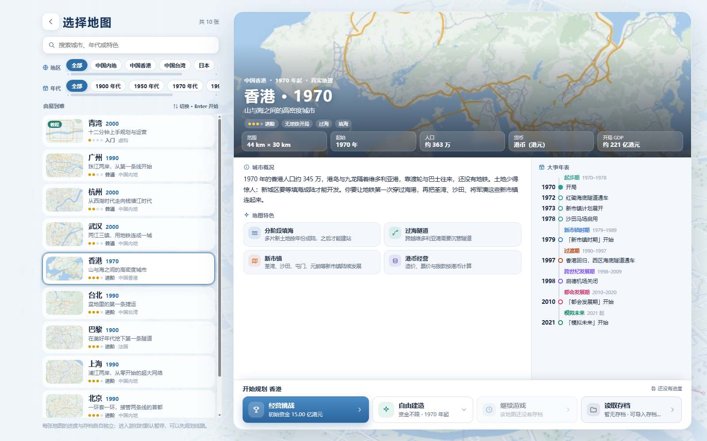
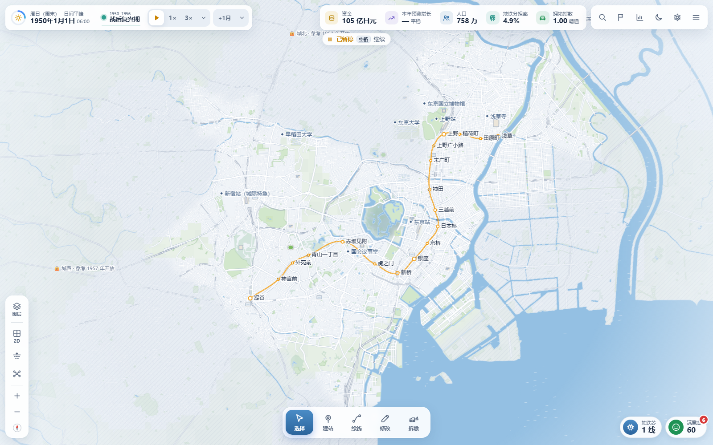
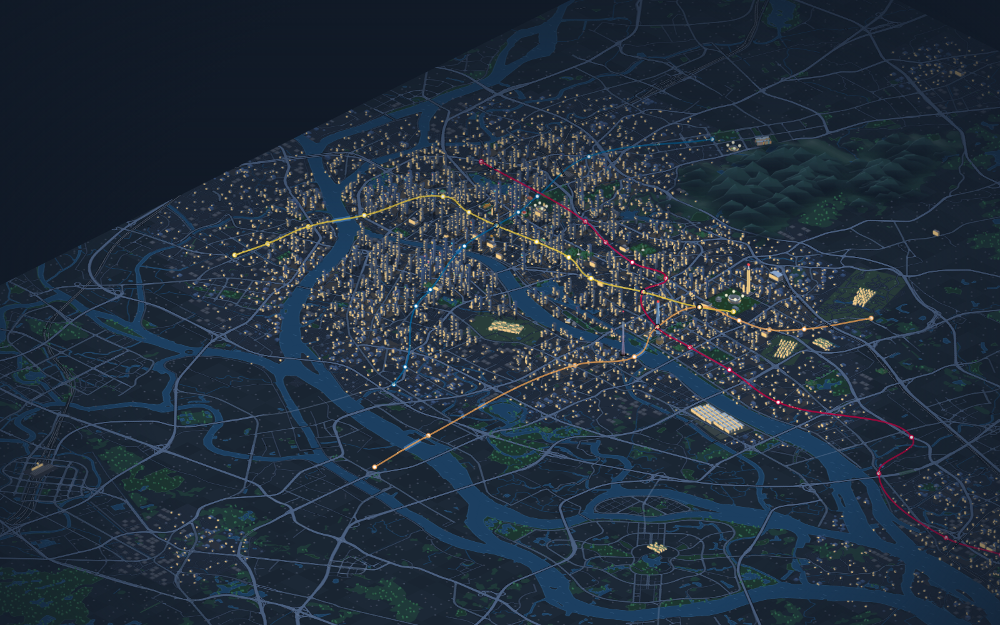
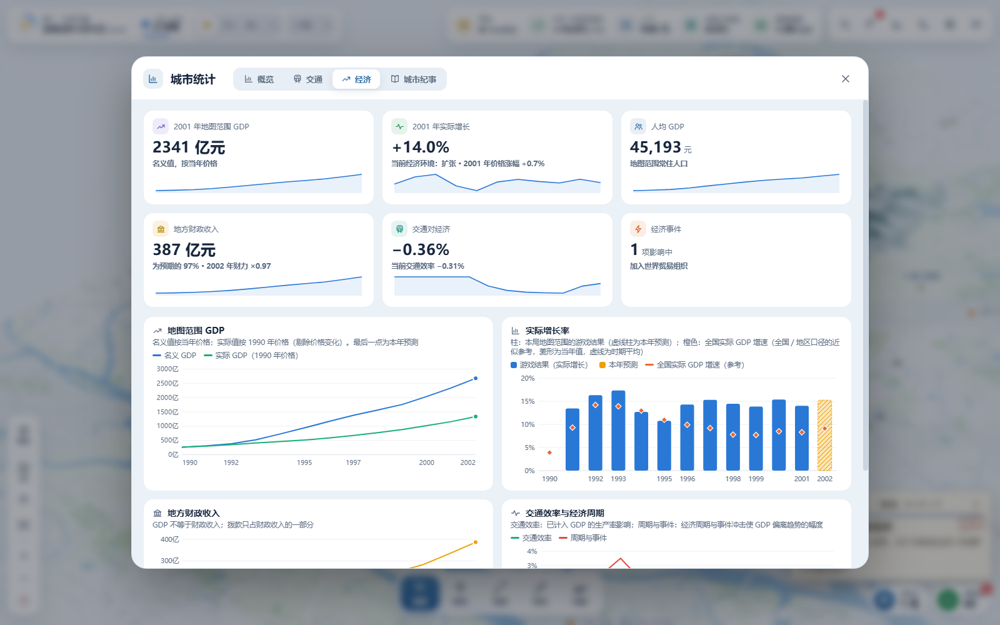

# 城市與地鐵

**繁體中文** · [English](./README.en.md)

**在真實城市裡，畫出你自己的地鐵。**

《城市與地鐵》是一款在瀏覽器中遊玩的單人地鐵規劃與城市經營遊戲。從第一座車站開始，連接住宅區、商圈、校園與機場，跨過江河，逐步織出自己的交通網路。城市隨年代發展，居民也會根據你的路網重新選擇出行方式。

**[線上遊玩](https://city-and-metro.yijiun.com)** · [本版原始碼](https://github.com/yijiunchin/city-and-metro) · [原版遊戲](https://city-and-metro.pages.dev) · [使用許可](./LICENSE.txt) · [第三方聲明](./THIRD_PARTY_NOTICES.txt)

> [!IMPORTANT]
> **這是社群修改版，不是官方版本。**
> 原作者：[VinsonFung](https://github.com/VinsonFung) · 原版網站：[城市與地鐵](https://city-and-metro.pages.dev) · 原始儲存庫：[VinsonFung/city-and-metro](https://github.com/VinsonFung/city-and-metro)
>
> 本版依原作者的社群改版規範發布，**嚴禁任何商業使用**。遊戲本體的問題與建議請以原版為準；本修改版新增的功能（帳號登入、雲端同步、語言自動偵測、Cloudflare Workers 部署）由本儲存庫維護，請勿向原始儲存庫提交與本版相關的 Pull Request。

---

## 目錄

- [本修改版新增了什麼](#本修改版新增了什麼)
- [遊戲特色](#遊戲特色)
- [遊戲截圖](#遊戲截圖)
- [城市與開局](#城市與開局)
- [開始遊玩](#開始遊玩)
- [帳號與雲端同步](#帳號與雲端同步)
- [介面語言](#介面語言)
- [本機存檔、匯入與匯出](#本機存檔匯入與匯出)
- [常用操作](#常用操作)
- [技術架構](#技術架構)
- [專案結構](#專案結構)
- [本機開發](#本機開發)
- [部署到 Cloudflare](#部署到-cloudflare)
- [API 參考](#api-參考)
- [測試與檢查](#測試與檢查)
- [舊版說明文件](#舊版說明文件)
- [版權與許可](#版權與許可)

---

## 本修改版新增了什麼

| 功能 | 說明 |
| --- | --- |
| **Google 帳號登入** | 可選功能。不登入時與原版完全相同，純本機遊玩。 |
| **跨裝置雲端同步** | 登入後，所有設定與全部存檔自動在電腦、手機、不同瀏覽器之間同步，並備份到雲端。 |
| **介面語言自動偵測** | 預設依瀏覽器或裝置語言顯示繁體中文、簡體中文或 English，也可手動固定。 |
| **Cloudflare Workers 部署** | 從 Cloudflare Pages 改為 Workers（靜態資源 + API），搭配 D1 與 R2，部署於 `city-and-metro.yijiun.com`。 |

遊戲本體同步至原版 **v2.5.1**。除了下方「本修改版修正的問題」，玩法、地圖、經濟與交通模型均沿用原版。

### 本修改版修正的問題

- **目標地點尚未開放的本城任務**：原版可能在目標地點所在片區開放前，就發布連接類的階段目標（例如東京 1956 年的「北千住換乘」，但北千住所在的城東 1962 年才開放），導致任務在期限內無法完成。本版改為片區開放後才發布；舊存檔中已發布的此類任務會在讀檔時撤回，不扣撥款、不降滿意度，片區開放後重新發布。

## 遊戲特色

- **選擇城市與年代。** 九座真實城市加一張青灣教學地圖，各有地形、發展階段與本地目標；自由建造還可以選擇起始年份、解鎖全圖。
- **規劃自己的路網。** 建設地下、地面和高架路線，設計曲線、環線、支線與分層轉乘，調整月台方向，拆分或貫通路線。草案可以預覽、復原，確認後投入營運。
- **經營一座城市的地鐵。** 選擇無限資金，或在經營挑戰中平衡建設、營運、票款、撥款與債務。透過客流、壅塞、步行覆蓋和建設效果報告判斷下一步。
- **跟著城市一起發展。** 新城區、機場、校園和景區隨年代啟用，歷史事件影響出行與經濟；完成設施接駁任務，查看階段總結和城市紀事。地圖外機場在邊界外顯示方向、距離與客流，將路線接到邊緣接駁口即可服務。
- **觀察路網裡的生活。** 在 2D、2.5D 與地下視圖中切換，跟隨列車進站，觀察街頭人車、城市地標與夜景。環境音隨鏡頭所在區域變化。
- **讓地鐵改變城市。** 車站開通後，居民的出行習慣逐步轉向地鐵，新增人口與就業更多向站點聚集。
- **開發和裝飾車站。** 建設廣告與便利商店、站內商店街、站城一體開發，增加非票務收入；為車站選擇風格、主題色、公共藝術與標誌。
- **管理車隊與交路。** 43 款車型依城市與年代開放，可購買、調配與出售；依尖峰、離峰與夜間調度列車，選擇 40–120 km/h 路線速度，開行快車與區間車。
- **用「地鐵芯」管理路網。** 集中管理總覽、路線、車站與列車，持續過載可定位或自動處理。
- **承擔政府合約。** 經營挑戰達到條件後，可投標新線 PPP、鐵路＋物業與擴容專案，依建設與營運考核收款。
- **完成複合目標。** 新任務同時考核路網、覆蓋、營運、收支或發展；九城另有 18 個可自行接受的策略難題。
- **十二種分析圖層與四個工具。** 包括通勤時間、搭地鐵比例、商業開發、測距、路線標註與任務標記。
- **桌面與手機皆可遊玩。** 觸控支援拖曳和雙指縮放，手機有專屬介面配置。

## 遊戲截圖

以下為原版 **v2.5.0** 的實機截圖。

### 選擇你的城市

十張地圖各有簡介、城市特色和分階段年表，地區與年代篩選可左右拖曳。



### 東京：從銀座線開始

1950 年開局接管淺草—澀谷之間的銀座線 18 站。



### 廣州：珠江兩岸的夜景

2.5D 視圖中的建築、江面、地標與地鐵路網。



### 從路網看到城市經濟

經濟統計展示 GDP、成長、地方財政與交通效率，數值均為遊戲模擬結果。



## 城市與開局

每格代表 250 公尺。真實城市的投影、道路與水域來自內建的 OpenStreetMap 地理資料。

| 地圖 | 格網 | 範圍（km） | 預設起年 | 規劃特色 |
| --- | --- | --- | --- | --- |
| 青灣 | 48×40 | 12×10 | 2000 | 虛構小城，13 步教學、約 12 分鐘，無限資金 |
| 廣州 | 120×144 | 30×36 | 1990 | 珠江兩岸、老城與天河，向番禺和大學城發展 |
| 杭州 | 188×136 | 47×34 | 2000 | 西湖、錢塘江、跨江新城與蕭山機場 |
| 香港 | 176×120 | 44×30 | 1970 | 山地海港、新市鎮、填海與赤鱲角機場 |
| 台北 | 136×120 | 34×30 | 1990 | 盆地、三河與多中心發展 |
| 北京 | 204×156 | 51×39 | 1990 | 接管 1 號線與環線 29 站，連接環路、奧運場館與副中心 |
| 東京 | 140×132 | 35×33 | 1950 | 接手銀座線 18 站，連接副都心與羽田機場 |
| 上海 | 152×152 | 38×38 | 1990 | 黃浦江、浦東開發、世博會與迪士尼 |
| 武漢 | 152×156 | 38×39 | 2000 | 兩江三鎮、東湖、光谷與天河機場 |
| 巴黎 | 152×148 | 38×37 | 1900 | 百年城市變遷、跨城通勤與兩大機場 |

九座真實城市均支援**經營挑戰**與**自由建造**，使用對應城市和年代的貨幣、票價及經營參數。後來的真實地鐵不會自動出現，路線完全由你規劃。

## 開始遊玩

1. 開啟 **<https://city-and-metro.yijiun.com>**。
2. 第一次玩建議先點主選單下方的「**新手教程 · 青灣**」。
3. 熟悉後點「**開始遊戲**」選擇城市、模式與起始年份。
4. 想在多台裝置接續進度，點主選單右上角的**雲朵圖示**登入 Google 帳號（見下一節）。

建議使用最新版的 Chrome、Edge、Firefox 或 Safari。

## 帳號與雲端同步

### 登入與登出

- **登入入口**：主選單右上角的雲朵圖示，或「設定 → 存檔 → 雲端同步」。
- 登入在**彈出視窗**中完成，遊戲畫面不會離開，進行中的地圖也不受影響。若瀏覽器攔截彈出視窗，會改為整頁跳轉（跳轉前會提醒你先存檔）。
- 登入後，主選單右上角改為顯示你的 Google 頭像；同步中會出現藍點，同步失敗會出現紅點。
- **登出**：「設定 → 存檔 → 雲端同步 → 退出登錄」。登出後本機的設定與存檔仍保留，但不再同步。在共用裝置上，可另外到「存檔管理」刪除本機存檔。
- 登入狀態保留 180 天。

### 同步哪些資料

| 資料 | 是否同步 | 說明 |
| --- | --- | --- |
| 全部設定 | ✅ | 介面語言、主題、介面大小、音量、地圖標註、自動存檔、按鍵配置、最近使用的路線顏色等 |
| 自動存檔 | ✅ | 每個進度的兩個自動存檔槽 |
| 手動存檔 | ✅ | 包括匯入的存檔 |
| 升級前備份 | ✅ | 舊存檔升級時自動建立的原始備份 |
| 進度名稱 | ✅ | 在任一裝置改名，其他裝置會跟著更新 |
| 刪除操作 | ✅ | 在任一裝置刪除存檔或整個進度，其他裝置也會刪除 |
| 交通計算快取 | ❌ | 可由存檔重新計算，不需同步 |
| 未確認的建設草案 | ❌ | 原版本來就不儲存草案 |

### 何時同步

- 開啟遊戲時（已登入）立即同步一次。
- 存檔（包括每月自動存檔）或修改設定後，數秒內自動同步；為避免頻繁上傳，最短每 20 秒同步一次，期間的變更會合併到下一次。
- 切回遊戲分頁、網路恢復連線時同步。
- 遊戲開啟期間每 5 分鐘檢查一次雲端更新。
- 也可以在「設定 → 存檔 → 雲端同步」按「立即同步」。

### 合併規則

雲端同步採**合併**而非覆蓋，第一次登入時本機已有的存檔不會遺失：

1. **存檔槽**：同一個存檔槽在兩台裝置都有時，保留**保存時間較新**的版本。
2. **刪除**：刪除會留下「墓碑」紀錄；只有晚於刪除時間的保存才會讓該存檔槽重新出現，因此不會被其他裝置「復活」。
3. **改名**：以最後一次改名的時間為準。
4. **設定**：整份設定以最後修改的時間為準。全新裝置（從未改過設定）登入時，會直接套用雲端設定。
5. **衝突重試**：兩台裝置同時同步時，伺服器以版本號偵測衝突，後到的一方會重新拉取、合併後再提交。

> [!NOTE]
> 若在兩台裝置**同時遊玩同一個進度**，自動存檔槽會以較晚的保存為準。建議在換裝置前先讓原裝置完成一次同步（看到「已同步」即可）。

### 雲端用量與刪除

- 存檔以 gzip 壓縮後上傳，「設定 → 存檔 → 雲端同步」會顯示目前的雲端占用量。
- 每個帳號的雲端存檔上限為 1 GB，單一存檔壓縮後上限 48 MB。
- 被刪除或被覆蓋的舊存檔，會在一小時後由伺服器自動清除。
- 「**刪除雲端數據**」會刪除雲端上的全部設定與存檔並登出，**本機存檔不受影響**，此操作無法復原。

### 隱私

登入時只向 Google 要求 `openid`、`email`、`profile` 三項基本權限。伺服器只儲存：

- Google 帳號識別碼、電子郵件、顯示名稱與頭像網址；
- 登入工作階段（只存雜湊值）；
- 你的設定與存檔內容。

不會取得 Google 雲端硬碟、聯絡人等其他資料，也不用於任何商業用途。

## 介面語言

- 支援**繁體中文**、**簡體中文**與 **English**。
- 預設為「**跟隨系統**」：依瀏覽器或裝置的語言偏好依序判斷——
  - 台灣、香港、澳門或標記為繁體（`zh-Hant`）→ 繁體中文
  - 其他中文 → 簡體中文
  - 英文及其他語言 → English
- 可在「設定 → 畫面 → 界面語言」改為固定語言；選擇會被記住，登入後也會同步到其他裝置。
- 語言只影響顯示，不會改變地圖、模擬與存檔中的原文。

## 本機存檔、匯入與匯出

即使不登入，遊戲也會完整保存進度：

- 存檔內容存在瀏覽器的 **IndexedDB**（不可用時退回 localStorage），存檔索引存在 localStorage。
- 支援**自動存檔**（每月結算與建設完成時，在兩個自動槽輪換）、**手動存檔**（每個進度最多 12 個）、存檔重新命名。
- 可在「存檔管理」把任何存檔**匯出為 JSON 檔**（`.cmsave.json`），或從檔案**匯入**。
- 舊版存檔升級前會自動保留一份原始備份；載入失敗時仍可從存檔清單匯出原始資料。
- 未登入時，存檔只存在目前的瀏覽器與網址，清除網站資料會一併刪除，請記得匯出備份或登入雲端同步。

## 常用操作

按鍵可在「設定 → 鍵位」中修改，遊戲內提示會同步更新。

| 操作 | 預設方式 |
| --- | --- |
| 平移／縮放 | 滑鼠左鍵拖曳、WASD／方向鍵；滾輪、`+`／`−` |
| 工具 | `V` 選取 · `B` 建站 · `L` 繪線 · `E` 修改 · `X`／`Delete` 拆除 · `O` 測距 |
| 繪線 | 依序點選；`Shift` + 點選新增轉彎點；滑鼠右鍵／`Enter` 結束 |
| 批次拆除 | 拆除工具中 `Ctrl` 點選多選、`Shift` 拖曳框選；`Enter`／`Delete` 執行 |
| 草案 | `Ctrl+Z` 復原 · `Ctrl+Y` 重做 · `Ctrl+Enter` 確認建設 |
| 時間 | `空白鍵` 暫停／繼續；`1`／`2`／`3`／`4` 切換速度；`.` 推進一月 |
| 視圖 | `T` 切換 2D／2.5D · `U` 地下 · `K` 路網圖 · `F` 全圖 |
| 圖層／沉浸 | `C`／`Shift+C` 切換分析圖層 · `H` 隱藏／顯示介面 |
| 常用入口 | `/` 搜尋 · `J` 任務 · `G` 統計 · `Ctrl+S` 儲存 · `F10` 設定 |
| 說明／選單 | `F1` 操作說明；`Esc` 暫停並開啟選單，彈出視窗內優先取消／返回 |

手機與平板：單指拖曳平移、雙指縮放，工具列與面板會自動改為觸控配置。

## 技術架構

```
瀏覽器（原生 HTML / CSS / JavaScript，無框架、無建置相依）
 ├─ 遊戲本體：Canvas 繪圖、城市與交通模擬、WebAssembly 道路計算（附 JS 回退）
 ├─ 本機儲存：IndexedDB（存檔）＋ localStorage（索引、設定）
 └─ js/cloud.js：登入狀態、同步排程、合併、gzip 壓縮
          │  fetch /api/*（同源 Cookie）
          ▼
Cloudflare Worker：city-and-metro（city-and-metro.yijiun.com）
 ├─ Static Assets：dist/（遊戲檔案，非 /api/* 的請求直接由此回應）
 ├─ worker/index.js：Google OAuth、工作階段、同步 API
 ├─ D1：city-and-metro（帳號、工作階段、同步索引、存檔清單）
 └─ R2：city-and-metro-saves（壓縮後的存檔內容）
          │
          ▼
Google OAuth 2.0（授權碼流程 + PKCE）
```

**設計重點**

- **本機為主、雲端為輔**：遊戲永遠先寫入本機，同步失敗或離線都不影響遊玩。
- **存檔內容不可變**：每次保存都產生唯一的存檔鍵，因此雲端存檔內容只需上傳一次，可長期快取；只有存檔「索引」需要合併。
- **一致性**：同步在存檔寫入佇列中執行，與本機保存串行；上傳完成後才提交索引，伺服器會拒絕引用尚未上傳存檔的索引。
- **安全性**：工作階段 Cookie 為 `HttpOnly; Secure; SameSite=Lax`，資料庫只存權杖雜湊；所有修改類請求須帶自訂標頭並通過來源檢查以防範 CSRF。

## 專案結構

```
city-and-metro/
├─ index.html              遊戲入口（依序載入 js/ 下的指令碼）
├─ css/style.css           全部樣式
├─ img/                    圖示、Logo 與截圖
├─ js/
│  ├─ util.js / config.js  共用工具與遊戲常數
│  ├─ i18n.js, locales/    介面語言（含自動偵測）與英文字串
│  ├─ geo_*.js, data_*.js  各城市地理與歷史資料
│  ├─ maps.js              地圖登記與遷移
│  ├─ city.js, metro.js, sim.js, economy.js, macro.js, game.js
│  │                       城市、路網、交通模擬、經濟與遊戲狀態
│  ├─ road-kernel.js       由 src-sim/ 產生的 WebAssembly 道路計算模組
│  ├─ save.js              本機存檔（IndexedDB / localStorage）
│  ├─ cloud.js             帳號登入與雲端同步（本修改版新增）
│  ├─ settings.js          設定
│  ├─ render.js, scenery.js, agents.js …  Canvas 繪圖與動畫
│  ├─ ui.js, screens.js, pages.js …       介面
│  ├─ vendor/              OpenCC（繁簡轉換）、pinyin-pro
│  └─ main.js              主迴圈（必須最後載入）
├─ worker/index.js         Cloudflare Worker：登入與同步 API（本修改版新增）
├─ migrations/             D1 資料表遷移（本修改版新增）
├─ wrangler.jsonc          Cloudflare Workers 設定
├─ scripts/                建置、發布清單與回歸測試
├─ src-sim/                道路計算的 Rust 原始碼與 Worker
├─ game-manifest.json      資源雜湊清單（由建置產生）
├─ PRD.md                  原版產品需求文件
├─ docs/legacy-readme/     原版 README（三語）
├─ LICENSE.txt, THIRD_PARTY_NOTICES.txt, licenses/
└─ dist/                   建置輸出（不納入版本控制）
```

## 本機開發

### 需求

- **Node.js** 20 以上（建置與測試腳本）
- **Wrangler** 4（Cloudflare CLI；可直接用 `npx wrangler`）
- 修改 `src-sim/road.rs` 時才需要 **Rust**（`rustc` 與 `wasm32-unknown-unknown` 目標）

### 只玩或修改遊戲本體

遊戲本體不需要安裝任何相依套件，直接用瀏覽器開啟 `index.html` 即可（`file://` 模式下雲端同步會自動隱藏）。也可以用任一靜態伺服器：

```sh
python3 -m http.server 8000
```

### 含登入與同步 API 的完整環境

```sh
# 1. 建置 dist/（Worker 的靜態資源目錄）
node scripts/build.mjs

# 2. 建立本機 D1 資料表
npx wrangler d1 migrations apply city-and-metro --local

# 3. 啟動本機 Worker（D1 與 R2 皆使用本機模擬）
npx wrangler dev
```

開啟 <http://localhost:8787> 即可。修改 `js/`、`css/` 後需重新執行 `node scripts/build.mjs`。

> [!TIP]
> 本機環境無法直接完成 Google 登入（Google 只接受正式網域的回呼網址）。要在本機測試同步，可以直接在本機 D1 建立測試帳號與工作階段，再把 Cookie `cm_sid` 設為對應權杖：
>
> ```sh
> TOKEN=local-test-token-0123456789abcdefghijklmnop
> HASH=$(node -e "console.log(require('crypto').createHash('sha256').update(process.argv[1]).digest('base64url'))" $TOKEN)
> NOW=$(node -e "console.log(Date.now())")
> npx wrangler d1 execute city-and-metro --local --command "
>   INSERT OR REPLACE INTO users (id, google_sub, email, name, picture, created_at, last_login)
>     VALUES ('u-test', 'sub-test', 'tester@example.com', 'Tester', NULL, $NOW, $NOW);
>   INSERT OR REPLACE INTO sessions (id_hash, user_id, created_at, expires_at)
>     VALUES ('$HASH', 'u-test', $NOW, $((NOW + 86400000)));"
> ```
>
> 然後在瀏覽器開發者工具中新增 Cookie：`cm_sid=local-test-token-0123456789abcdefghijklmnop`。

## 部署到 Cloudflare

以下是從零部署一套自己的社群版所需的步驟。**部署社群版時，請遵守下方[版權與許可](#版權與許可)的署名與非商業要求。**

### 1. 建立 Cloudflare 資源

```sh
npx wrangler login
npx wrangler d1 create city-and-metro
npx wrangler r2 bucket create city-and-metro-saves
```

把 `d1 create` 輸出的 `database_id` 填入 `wrangler.jsonc`，並依需要修改：

| 欄位 | 用途 |
| --- | --- |
| `account_id` | 你的 Cloudflare 帳號 ID |
| `routes[0].pattern` | 你的自訂網域（該網域須已託管在同一個 Cloudflare 帳號） |
| `d1_databases[0].database_id` | 上一步建立的 D1 資料庫 ID |
| `vars.GOOGLE_CLIENT_ID` | 下一步取得的 Google OAuth 用戶端 ID |

### 2. 建立 Google OAuth 用戶端

1. 前往 [Google Cloud Console](https://console.cloud.google.com/) → **APIs & Services**。
2. **OAuth consent screen**：使用者類型選 **External**，填寫應用程式名稱與聯絡信箱；範圍只需 `openid`、`email`、`profile`（皆為非敏感範圍，不需 Google 審查）。完成後**發布為正式版**，否則只有測試使用者能登入。
3. **Credentials → Create credentials → OAuth client ID**：
   - Application type：**Web application**
   - Authorized redirect URIs：`https://<你的網域>/api/auth/callback`
4. 把 **Client ID** 填入 `wrangler.jsonc` 的 `vars.GOOGLE_CLIENT_ID`。
5. 把 **Client Secret** 設為 Worker 機密（請在自己的終端機互動輸入，不要寫進任何檔案）：

   ```sh
   npx wrangler secret put GOOGLE_CLIENT_SECRET
   ```

### 3. 建立資料表並部署

```sh
node scripts/build.mjs
npx wrangler d1 migrations apply city-and-metro --remote
npx wrangler deploy
```

`wrangler deploy` 會自動為自訂網域建立 DNS 紀錄與憑證。

### 4. 驗證

```sh
curl https://<你的網域>/api/me
# 應回傳 {"user":null,"configured":true}
```

`configured` 為 `false` 代表 `GOOGLE_CLIENT_ID` 或 `GOOGLE_CLIENT_SECRET` 未設定（或機密值為空）。

### 之後更新

push 到 `main` 時，GitHub Actions（`.github/workflows/deploy.yml`）會自動執行測試、建置、套用 D1 遷移並部署。首次使用前，需在 Cloudflare 以「Edit Cloudflare Workers」範本建立 API Token，並額外加上 **D1:Edit** 權限，再存成儲存庫 secret：

```sh
gh secret set CLOUDFLARE_API_TOKEN
```

也可以在 Actions 頁面手動執行「Deploy」。需要手動部署時：

```sh
node scripts/build.mjs && npx wrangler deploy
```

新增資料表遷移時，記得先執行 `npx wrangler d1 migrations apply city-and-metro --remote`。

## API 參考

所有 API 皆為同源呼叫並以 Cookie 驗證。除 `GET` 外，請求須帶標頭 `X-CM-Client: 1`。

| 方法 | 路徑 | 說明 |
| --- | --- | --- |
| `GET` | `/api/me` | 目前登入的使用者（未登入為 `null`）與登入服務是否已設定 |
| `GET` | `/api/auth/login` | 轉向 Google 登入；`?popup=1` 時登入完成後由 `/api/auth/done` 通知遊戲頁並關閉視窗 |
| `GET` | `/api/auth/callback` | Google OAuth 回呼，建立工作階段 |
| `GET` | `/api/auth/done` | 彈出視窗登入完成頁 |
| `POST` | `/api/auth/logout` | 登出並刪除工作階段 |
| `GET` | `/api/sync` | 取得雲端狀態：`rev`、`state`（存檔索引、墓碑、設定）、`bytes` |
| `PUT` | `/api/sync` | 以 `baseRev` 樂觀鎖提交新狀態；版本衝突回傳 `409`，引用未上傳存檔回傳 `422` |
| `DELETE` | `/api/sync` | 刪除雲端全部設定與存檔 |
| `GET` | `/api/blob/:key` | 下載一個存檔（gzip） |
| `PUT` | `/api/blob/:key` | 上傳一個存檔（gzip）；鍵不可變，重複上傳會直接略過 |

**D1 資料表**（見 `migrations/0001_init.sql`）：`users`、`sessions`、`sync_state`、`blobs`。R2 物件路徑為 `u/<使用者 ID>/<存檔鍵>`。

## 測試與檢查

```sh
node scripts/build.mjs                 # 建置 dist/ 並驗證資源與發布清單
node scripts/verify-game.mjs --dist    # 驗證 dist/ 與 game-manifest.json 一致
node scripts/test-map-migrations.mjs   # 地圖版本遷移
node scripts/test-v22.mjs              # v2.2 玩法、存檔與繪圖回歸
node scripts/test-v23.mjs              # v2.3 回歸
node scripts/test-v24.mjs              # v2.4 回歸
node scripts/test-v25.mjs              # v2.5 合約、車隊與複合任務回歸
node scripts/test-v251.mjs             # v2.5.1 回歸
node scripts/test-development-layer.mjs  # 城市發展圖層
node scripts/test-save-storage.mjs     # 瀏覽器存檔儲存
CM_BROWSER=<Chromium 執行檔> node scripts/test-mobile-layout.mjs  # 手機版面（需要 Chromium）
node scripts/test-web-sync.mjs         # 網頁版整合回歸
```

修改任何遊戲檔案後，需重新產生 `game-manifest.json`（`node scripts/build.mjs` 或 `node scripts/verify-game.mjs --write`），否則驗證會失敗。修改 `src-sim/road.rs` 後需執行 `node scripts/build-road-kernel.mjs` 重新產生 `js/road-kernel.js`。

## 舊版說明文件

原版 README 保留在 [`docs/legacy-readme/`](./docs/legacy-readme/)：

- [简体中文](./docs/legacy-readme/README.md)
- [繁體中文](./docs/legacy-readme/README.zh-TW.md)
- [English](./docs/legacy-readme/README.en.md)

原版的玩法與驗收需求見 [PRD.md](./PRD.md)，玩家更新公告見 [js/news.js](./js/news.js)。

## 版權與許可

**Copyright © 2026 VinsonFung。保留所有權利，嚴禁商業使用。**

- 本儲存庫是《城市與地鐵》的**社群修改版**。原作者 [VinsonFung](https://github.com/VinsonFung)，原版網站 [city-and-metro.pages.dev](https://city-and-metro.pages.dev)，原始儲存庫 [VinsonFung/city-and-metro](https://github.com/VinsonFung/city-and-metro)。
- 非商業學習、研究、遊玩、修改及分享須遵守 [LICENSE.txt](./LICENSE.txt)。
- **原版及社群改版均嚴禁商業使用**：不得收費遊玩、販售、投放廣告、接受商業贊助或用於其他商業變現；免費發布、修改或改名不構成例外。
- 若再次修改並部署本版，請在網站醒目位置標註這是社群修改版，保留上述原作者署名與連結，清楚說明自己的修改，不要冒充官方版本。
- 第三方程式碼、資料與資源保留各自授權條款；OpenStreetMap 地理資料遵循 ODbL 1.0，詳見[第三方聲明](./THIRD_PARTY_NOTICES.txt)。
